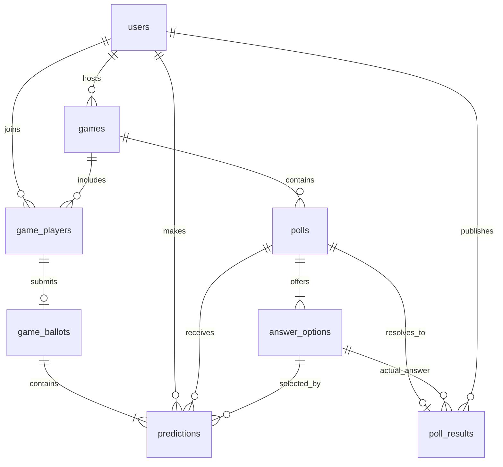

# The Tea database schema

This is the canonical human-readable artifact for The Tea database. The
executable PostgreSQL definition lives in [`schema/001_initial.sql`](schema/001_initial.sql).
Whenever a migration adds, removes, or changes a table or column, update this
artifact in the same commit.

## Relationship map

All primary identifiers are UUIDs. All timestamps are PostgreSQL `timestamptz`
values stored in UTC. Application code is responsible for updating `updated_at`
values and enforcing multi-row lifecycle and authorization rules.

## Table: `users`

Registered accounts used by both hosts and players.

| Column | Type | Null? | Default | Constraints / meaning |
| --- | --- | --- | --- | --- |
| `id` | `uuid` | No | `gen_random_uuid()` | Primary key |
| `email` | `citext` | No | — | Unique, case-insensitive login identity |
| `first_name` | `varchar(80)` | No | — | Trimmed length 1–80; shown in rosters and leaderboards |
| `password_hash` | `text` | No | — | Password hash only; never plaintext |
| `is_active` | `boolean` | No | `true` | Flask-Login account state |
| `created_at` | `timestamptz` | No | `now()` | Creation time |
| `updated_at` | `timestamptz` | No | `now()` | Last application update |

## Table: `games`

A hosted prediction party with one scoring policy and one lifecycle.

| Column | Type | Null? | Default | Constraints / meaning |
| --- | --- | --- | --- | --- |
| `id` | `uuid` | No | `gen_random_uuid()` | Primary key |
| `host_user_id` | `uuid` | No | — | Foreign key to `users.id` |
| `title` | `varchar(120)` | No | — | Trimmed length 1–120 |
| `description` | `text` | Yes | — | Optional host-written summary |
| `join_code` | `citext` | No | — | Unique host-chosen eight-character game password |
| `status` | `varchar(16)` | No | `draft` | `draft`, `open`, `locked`, `revealing`, or `completed` |
| `exact_points` | `smallint` | No | `3` | Points for the exact option; non-negative |
| `group_points` | `smallint` | No | `1` | Points for a different option in the same scoring group |
| `incorrect_points` | `smallint` | No | `0` | Points for a different scoring group |
| `locked_at` | `timestamptz` | Yes | — | Required once status is locked or later |
| `completed_at` | `timestamptz` | Yes | — | Required when completed |
| `created_at` | `timestamptz` | No | `now()` | Creation time |
| `updated_at` | `timestamptz` | No | `now()` | Last application update |

Scoring must satisfy `exact_points >= group_points >= incorrect_points`.

## Table: `game_players`

Membership between users and games. Rows remain for history when someone leaves
or is removed.

| Column | Type | Null? | Default | Constraints / meaning |
| --- | --- | --- | --- | --- |
| `game_id` | `uuid` | No | — | Foreign key to `games.id`; part of composite primary key |
| `user_id` | `uuid` | No | — | Foreign key to `users.id`; part of composite primary key |
| `role` | `varchar(12)` | No | `player` | `host` or `player`; one host row per game |
| `status` | `varchar(12)` | No | `joined` | `joined`, `left`, or `removed` |
| `joined_at` | `timestamptz` | No | `now()` | Initial join time and tie-break input |
| `updated_at` | `timestamptz` | No | `now()` | Last membership update |

Primary key: (`game_id`, `user_id`). Indexes support one host per game and a
user's game list.

## Table: `game_ballots`

One player's final, atomic submission for one game. A ballot and all of its
prediction rows are inserted in the same transaction.

| Column | Type | Null? | Default | Constraints / meaning |
| --- | --- | --- | --- | --- |
| `id` | `uuid` | No | `gen_random_uuid()` | Primary key |
| `game_id` | `uuid` | No | — | Part of the FK to an active game membership |
| `user_id` | `uuid` | No | — | Part of the FK to an active game membership |
| `submitted_at` | `timestamptz` | No | `now()` | Final submission time |

Unique key: (`game_id`, `user_id`). The (`id`, `user_id`) pair is also unique so
every prediction can be guaranteed to belong to that user's ballot.

## Table: `polls`

An ordered prediction question within a game.

| Column | Type | Null? | Default | Constraints / meaning |
| --- | --- | --- | --- | --- |
| `id` | `uuid` | No | `gen_random_uuid()` | Primary key |
| `game_id` | `uuid` | No | — | Foreign key to `games.id`; cascades on game deletion |
| `prompt` | `varchar(280)` | No | — | Trimmed question, length 1–280 |
| `position` | `integer` | No | — | Positive display order, unique inside the game |
| `created_at` | `timestamptz` | No | `now()` | Creation time |
| `updated_at` | `timestamptz` | No | `now()` | Last application update |

The (`id`, `game_id`) pair is also unique to support scoped relationships.

## Table: `answer_options`

An ordered selectable answer. Keys and labels are theme configuration rather
than hard-coded database categories.

| Column | Type | Null? | Default | Constraints / meaning |
| --- | --- | --- | --- | --- |
| `id` | `uuid` | No | `gen_random_uuid()` | Primary key |
| `poll_id` | `uuid` | No | — | Foreign key to `polls.id`; cascades on poll deletion |
| `option_key` | `varchar(64)` | No | — | Stable snake-case key, unique inside the poll |
| `label` | `varchar(120)` | No | — | Player-facing label, trimmed length 1–120 |
| `scoring_group_key` | `varchar(64)` | No | — | Stable snake-case group used for partial credit |
| `position` | `integer` | No | — | Positive display order, unique inside the poll |
| `created_at` | `timestamptz` | No | `now()` | Creation time |

The (`id`, `poll_id`) pair is unique so a prediction or result can be guaranteed
to use an option belonging to its poll.

Initial game configuration:

| `option_key` | Player label | `scoring_group_key` |
| --- | --- | --- |
| `married` | Married | `married` |
| `together_not_married` | Together, not married | `no_marriage` |
| `broken_up` | Broken up | `no_marriage` |

## Table: `predictions`

One user's current answer for one poll, plus the points awarded after reveal.

| Column | Type | Null? | Default | Constraints / meaning |
| --- | --- | --- | --- | --- |
| `id` | `uuid` | No | `gen_random_uuid()` | Primary key |
| `ballot_id` | `uuid` | No | — | Composite FK with `user_id` to `game_ballots` |
| `poll_id` | `uuid` | No | — | Poll being predicted; unique with `user_id` |
| `user_id` | `uuid` | No | — | Foreign key to `users.id` |
| `answer_option_id` | `uuid` | No | — | Selected option; composite FK ensures it belongs to `poll_id` |
| `awarded_points` | `smallint` | Yes | — | Null before reveal, then a non-negative scoring snapshot |

Unique key: (`poll_id`, `user_id`). All rows are submitted with their parent
ballot. Submission is final: the service returns the existing ballot for an
identical retry and rejects different answers. Poll options and scoring settings
remain frozen while voting is open.

## Table: `poll_results`

The immutable actual answer published by the host through **Spill the Tea**.

| Column | Type | Null? | Default | Constraints / meaning |
| --- | --- | --- | --- | --- |
| `poll_id` | `uuid` | No | — | Primary key and FK to `polls.id`; at most one result per poll |
| `answer_option_id` | `uuid` | No | — | Actual option; composite FK ensures it belongs to `poll_id` |
| `published_by_user_id` | `uuid` | No | — | Foreign key to the publishing `users.id` |
| `published_at` | `timestamptz` | No | `now()` | Reveal time and leaderboard revision input |

Publishing a result and writing `predictions.awarded_points` happen in one
transaction. The MVP does not allow result corrections; that needs a later,
explicitly audited design.

## Application-enforced rules

These rules cross multiple rows and are enforced in transactional service code:

- `games.host_user_id` and the single host membership refer to the same user.
- Every prediction belongs to an active member of the poll's game.
- A complete ballot can be submitted only while the game is `open`; its
  predictions cannot be changed after submission.
- Ballot creation and all prediction inserts occur in one transaction. The
  service rejects ballots that omit a poll or select multiple options per poll.
- Polls, options, and scoring values become immutable when predictions lock.
- Only the host can lock, reveal a result, or complete a game.
- A result can be published only while the game is `locked` or `revealing`.
- Other players' predictions remain private until the relevant result is public.
- Aggregate option counts and percentages become visible to a player only after
  that player casts a final vote; individual answers remain private.
- Every joined player appears in the game roster and leaderboard, including
  players with zero points or no scored predictions.

